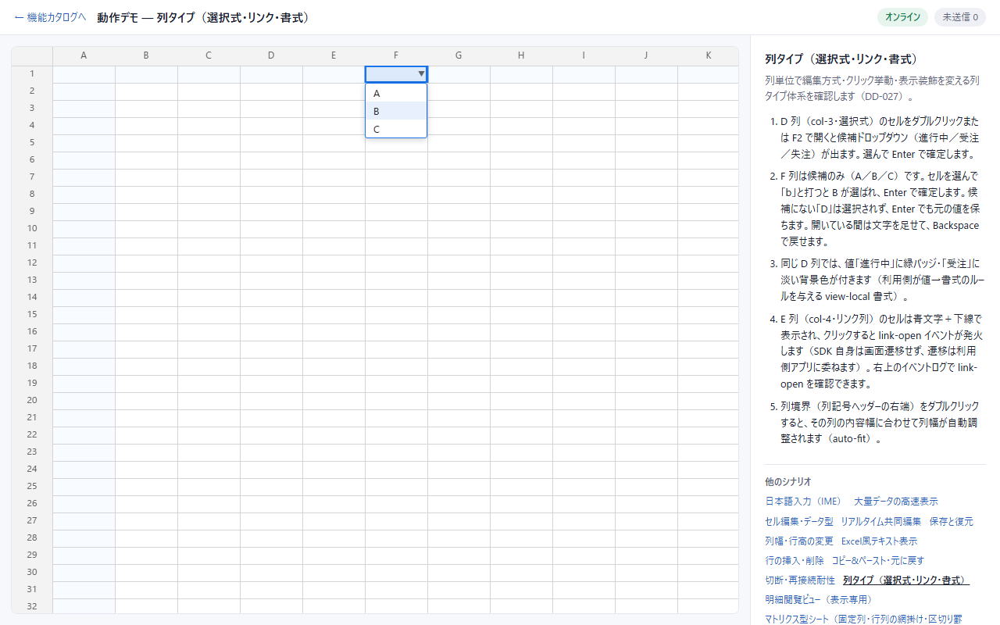

# 広島空港 H14 引き渡し — DD-057

## 配布物

- 版: `0.1.0-alpha.13`（API版 `0.1.0-experimental` は維持）。alpha.12 の H11〜H13 を含む。
- フォルダ: `C:/repo/spreadjs/release/0.1.0-alpha.13/`（10 tarball＋manifest＋README）。
- ZIP: `C:/repo/spreadjs/release/nanairo-sheet-0.1.0-alpha.13.zip`。
- ZIP は12 entries・388,290 bytes。各 entry の SHA-256 が配布フォルダの元ファイルと一致することを確認した。ZIP の SHA-256 は `AD0A14183CDFE6CF9BBA79CAC8B7A10ECAC53D08C721A7DC812A4EA7FD67CC12`。
- 生成元: `f7574f3f246191d7dfc81502c3e0a0220448a8e1`、manifest の `closureDirty=false`。
- 10 tarball の版・bytes・SHA-256 と manifest の一致、公開 entrypoint と pack 内容を検証済み。

`grid/react/server-hono/core/types/collab/render/selection/ime/server` の全10パッケージを同時に更新する。
既存 vendor・package.json・lockfile を復元できる状態で取り込み、consumer の vendor パスで install する。
manifest の install は tarball と同じディレクトリが前提。`formula` は配布対象外。

## H14 の契約

対象は候補のみの選択式列（`allowFreeText:false`、省略時も同じ）。

| 操作 | 結果 |
|---|---|
| 空欄で `B` または `b` → Enter（候補 A/B/C） | B を選び、B を1回だけ確定・送信する |
| `7` → `2` → `1`（候補 716 電力費/721 保安費/723 修繕費） | 入力を追加し、最初の前方一致で 721 保安費を選ぶ |
| Backspace | 入力末尾を1文字消し、最初の前方一致を選び直す。全消去は選択なし |
| 不一致 `D` → Enter | ハイライトなし。閉じるだけで現在値を保持し、送信しない |
| F2/Enter/Alt+↓/ダブルクリック | 従来どおり現在値か先頭を選んで開く |
| ↑↓・候補クリック | 従来どおり明示的に候補を選ぶ |
| Esc/Tab・閉じて開き直す | 検索文字をリセットする |

候補は全件表示したまま、大小文字を区別せず先頭から一致を探す。時間で文字をリセットしない。
自由入力併存列（`allowFreeText:true`）の picker/suggest・IME 経路は従来どおり。
日本語 IME の確定文字で候補を検索する機能は非提供。日本語候補は矢印・クリックで選ぶ。

公開シグネチャ・認可・DBスキーマ・protocol・snapshot の変更はない。
操作仕様の変更と、印字文字を捨てていた従来動作への影響は `CHANGELOG.md` に記録した。

## SDK 側の確認

| 確認 | 結果 |
|---|---|
| unit/invariants/contract | 135ファイル・1,448件 green |
| playground E2E | 全253件 green（対象22件を含む） |
| showcase E2E | 全5件 green（F列の b → B と D の不一致を含む） |
| 型検査・consumer-strict | green |
| lint/boundary・production build | green |
| pack/manifest | 10 tarball・114ファイル、全 entrypoint あり。SHA-256 一致、closureDirty=false |
| 独立 consumer-app | 配布物を直接 install。型検査・server lifecycle・production build・E2E 10件 green（9.8秒） |
| 独立 consumer-harness | closure の pack→install→型検査 green。内部 import・source path・workspace link なし |

実装・対象テスト完了時に自己見直しを行い、未選択 Enter、検索リセット、IME/freeText/readOnly 分岐、行消失/OCC/Undo の確定経路を確認した。
追加修正を要する所見なし。公開宣言 snapshot の差分は操作説明の3行のみで、型の変化はない。
初回の全 E2E で発生した再読込と、showcase テストのセル選択手順の修正は [DD 本体](../DD-057_候補のみの選択式列で打った文字を選択に使う.md) のログに記録している。

## 広島側へ移送する確認

広島 `doc/poc/sdk-requirements.md` H14 の「取り込み結果」は広島側で更新する（DDP-007）。

1. alpha.13 を10パッケージ一括で取り込み、vendor manifest・SHA-256・lockfile・インストール版を確認する。
2. 入力画面の確度で空欄に B → Enter、科目で 721 → Enter、不一致 D → Enter を確認する。
3. 別ウィンドウと DB へ B / 721 保安費が届き、不一致では値が変わらないことを確認する。
4. 台本 D2・D3 をキーボードで候補を選ぶ手順に戻して通す。

広島への実取り込み・業務画面/DB・台本通し・商談受入は今回未実施。実OS IME T1 も未実施。
日本語 IME 検索は別仕様として扱う。Git push・registry publish は行っていない。
