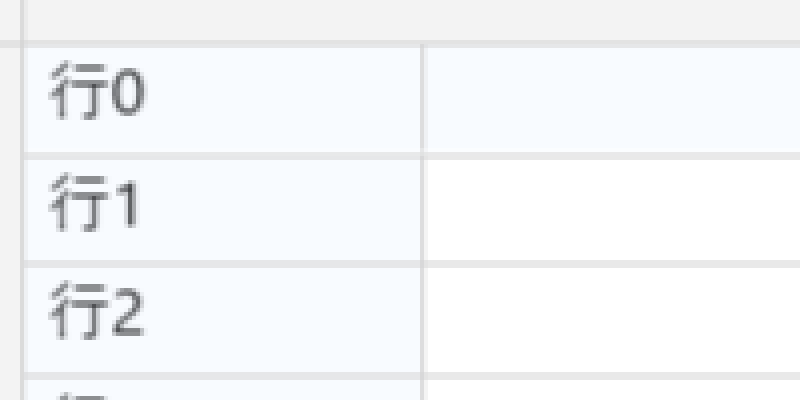
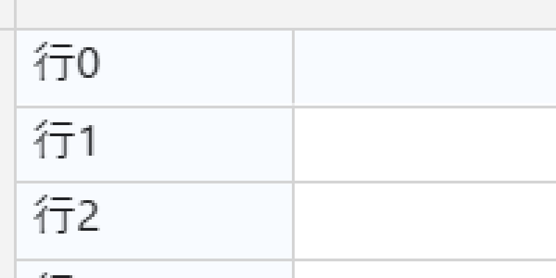

# DD-058 検証記録（2026-10-14）

## 画素検証

Playwright Chromium149.0.7827.55 / headless / viewport1280×800。修正前はCSS(17,197.77)・1000×500、修正後は同じ原点で1001×501（CSS×DPRが端数になるサイズも検証）。白合成のbitmapとpage.screenshotの実画素を比較。overlay/DOM編集欄を除外し、bitmapに文字が描かれていることも検査する。

| DPR | 修正前 平均差 / 最大差（600×200px） | 修正後 平均差 / 最大差 | 位置移動後 | 整数px移動後 |
|---|---|---|---|---|
| 1 | 0 / 0 | 0 / 0 | 0 / 0 | 0 / 0 |
| 1.25 | 1.87254 / 126 | 0 / 0 | 0 / 0 | 0 / 0 |
| 1.5 | 0.84492 / 84 | 0 / 0 | 0 / 0 | 0 / 0 |
| 1.75 | 1.70552 / 127 | 0 / 0 | 0 / 0 | 0 / 0 |
| 2 | 0 / 0 | 0 / 0 | 0 / 0 | 0 / 0 |

修正後はcanvas右端近くまで（width969〜1970device px）×350pxを比較。DPR1.25→1.5→2→1.25のCSSサイズを変えない遷移も全画素差0、backing幅はround(1001×DPR)、ResizeObserverの通知数は増えない。

125%の同じ領域を4倍表示（補間なし）:

修正前:

修正後:

- AC1/2/3: 5種類のDPRすべて平均/最大差0。原点の計算誤差 <0.0001 device px。
- AC4: 同サイズでCSS(17.375,231.145)へ移動し、さらに(4,4)px移動しても全画素差0。
- AC5: base/overlayの原点一致。論理stageに対する補正は≤0.501device px。既存unit/E2Eの仕様・シナリオを変更せず検証した。
- AC6: 単独DPR変更のunitと実ブラウザーCDPで検証。キャッシュ・dirtyの更新は既存syncLayoutを共用する。

PNG/JSON: `bug001-before-*`、`bug001-candidate-*`、`bug001-after-*`。方式比較は `phase0.json`、位置読みの実測は `layout-research.json`。再実行例: `DD058_EVIDENCE_DIR=<このフォルダ> npm run test:e2e -- canvas-dpi.spec.ts`。

## 回帰・ビルド

- `npm test`: 136ファイル・1457件green（unit/invariants/contract/features smoke）。
- `npm run typecheck`、`npm run typecheck:consumer-strict`、`npm run lint`（boundary含む）、`npm run build`: green。
- 全playground E2E: 初回258/259green、既存起動待ち競合1件。対象のrow-operations15件を変更なしで再実行し全green。最終DPI6件も全green。初回結果を「全件一発green」とは扱わない。
- 既存性能E2Eはgreen。382列×80行の初回描画73.1ms、frame p95=16.7ms、入力確定0.8ms。罫線/行背景のframe p95約16.7〜16.8ms。
- 自己レビューは [self-review.md](self-review.md)。採用した所見と未保証境界を記録した。

## 配布

alpha.14の配布manifestと独立consumer検証は [handoff.md](handoff.md) に記録する。

## 既知の未保証境界

実機ChromeのGPU合成・Windows表示スケール125%の目視、広島PoCの取り込みと実入力画面・商談受入は未実施。DOM文字とCanvas文字のAA差は対象外。機械試験の結果を実機acceptanceへ読み替えない。
