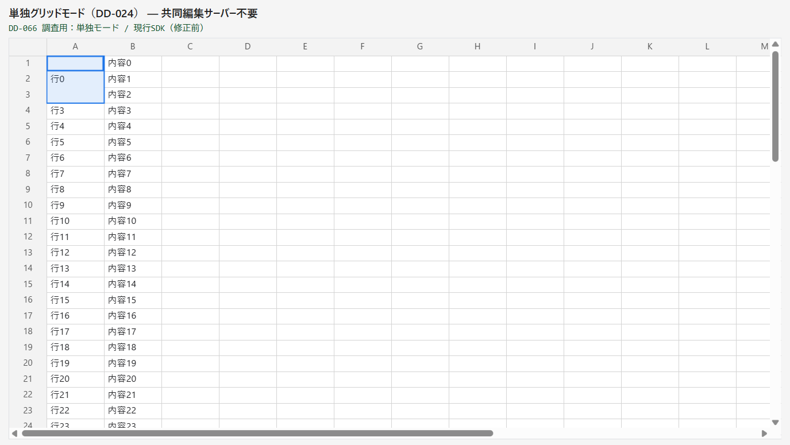
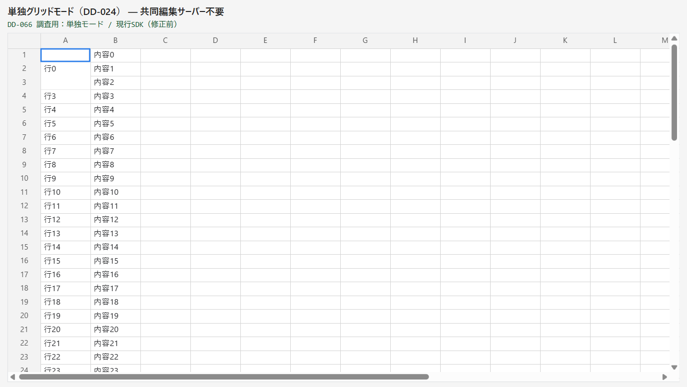
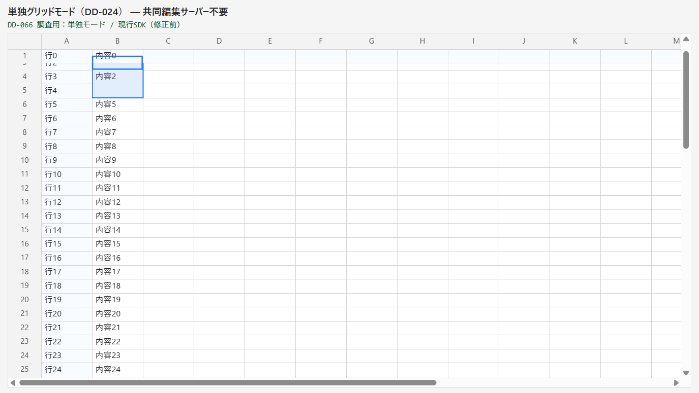
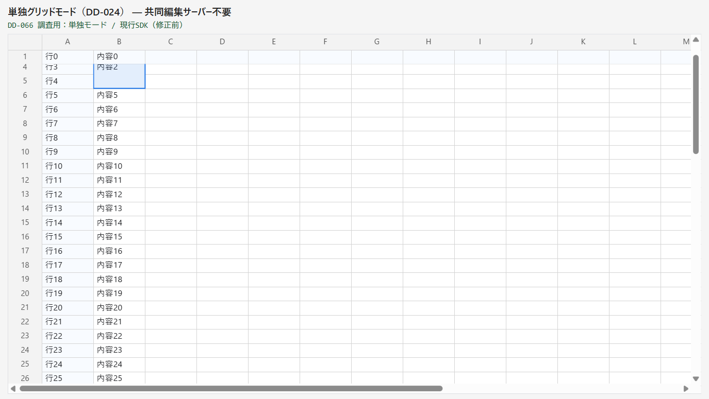
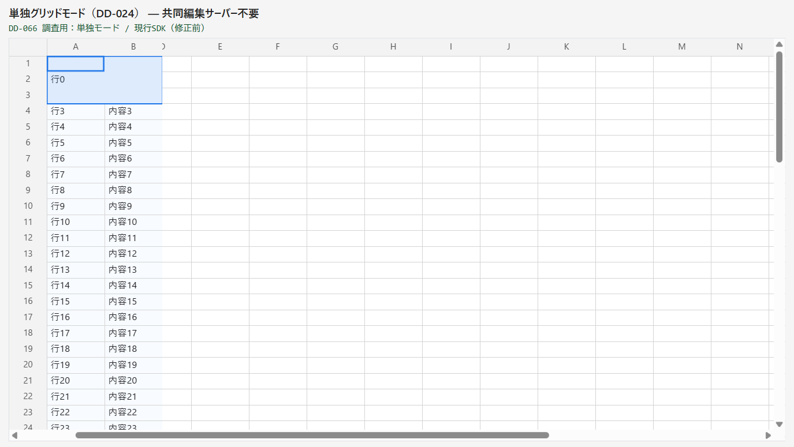

# DD-066 修正前のバグ再現レポート

確認日: 2026-11-08。現行ソース `7951231`、Windows・Chrome 156（Playwright MCP）。viewport=1100×620 CSS px、DPR≈1.25。画面キャプチャの解像度と下記の CSS px は異なる。

## Bug#1: 結合の外枠の中に1行ぶんの枠が重なる



上から3行を1つに結合している。Canvas の外枠は3行全体を囲むが、textarea の青い枠が1行目の下に残る。

| 場面 | 正しい結合の矩形（CSS px） | 実際の textarea | 結果 |
|---|---|---|---|
| 3行×1列をクリック | x=52,y=24,80×66 | x=52,y=24,80×22 | 二重枠を再現 |
| 自動 focus なしの mount 直後 | x=52,y=24,80×66 | x=52,y=24,80×22 | 1セルの枠だけを表示 |
| クリック後に blur | x=52,y=24,80×66 | x=52,y=24,80×22 | 外枠は残り、二重枠も残る |
| 固定1行・上端が一部隠れる | x=132,y≈34.667,80×66。表示は y≥46 | x=132,y≈34.667,80×22、clipなし | 枠が固定行へ約11.333pxはみ出す |
| 左上セルは全部隠れ、結合の下側だけ見える | x=132,y=18,80×66。y=46..84は可視 | `display:none` | 結合全体で可視判定できていない |
| 固定2列の中を横スクロール120 | x=52,y=24,160×66 | x=52,y=24,80×22 | 横・縦とも1セルの枠のまま |

### mount 直後と blur を分けた確認

| 初期表示（focusなし） | クリックした後に blur |
|---|---|
|  |  |

同じ focus=false でも、後者では外枠と塗りが残る。原因は focus の有無ではなく、初期選択が overlay へ反映済みかどうか（`cause-analysis.md`）。

### スクロール境界

| 結合の上端が固定行の下へ隠れる | 左上セルは隠れ、結合の下側は見える |
|---|---|
|  |  |

比較用の通常の1セルでも、上端の枠のはみ出しは現存する（`before-single-partial-top.png`）。通常セルの配置の変更は対象外とし、結合セルの枠だけを pane の中に収める。



## 再現手順

1. ルートで `npm run dev --workspace apps/playground -- --host 127.0.0.1 --port 5885 --strictPort` を起動する
2. `http://127.0.0.1:5885/standalone.html?frozenrows=0&frozencols=0&merged=%5B%7B%22rowId%22%3A%22r0%22%2C%22columnId%22%3A%22col-a%22%2C%22rowSpan%22%3A3%7D%5D` を開き、最初の3行の結合をクリックする。標準 playground は自動 focus するため、このままでは focus なしの初期表示を分離できない
3. 初期表示の確認では、同じページで既存の instance を destroy し、次の public `mount()` を実行する。`instance.focus()` は呼ばない

```js
window.__gridInstance?.destroy();
window.__standalone.destroy();
const { mount } = await import('/@fs/C:/repo/spreadjs/packages/grid/src/index.ts');
const { getDebugApi } = await import('/@fs/C:/repo/spreadjs/packages/grid/src/test-support.ts');
const columnOrder = ['col-a', 'col-b', 'col-c', 'col-d',
  ...Array.from({ length: 16 }, (_, i) => `col-x${i}`)];
const initialData = { rows: Array.from({ length: 80 }, (_, i) => ({
  rowId: `r${i}`, cells: { 'col-a': `行${i}`, 'col-b': `内容${i}` },
})) };
const instance = mount({ container: document.getElementById('int-stage') }, {
  mode: 'standalone', columnOrder, initialData,
  frozenRowCount: 0, frozenColumnCount: 0,
  mergedCells: [{ rowId: 'r0', columnId: 'col-a', rowSpan: 3 }],
});
window.__gridInstance = instance;
window.__integrationTestApi = getDebugApi(instance);
```

4. 初回描画を待ち、textarea の style の width/height と debug API の `cellRectAt()`・`mergedRanges()` を比較する。結合の中をクリックし、その後 textarea を blur して同じ観測を行う
5. 上端の確認は fixed=1行・1列、結合=r2/col-bから3行へ変え、初回描画後に `setActiveCell('r2','col-b')` → focus → `.nsheet-scroller.scrollTop=33`。スクロール量は DPR で約33.333へ丸められたため、テストでは小数の一致を要求しない
6. 左上全部不可視は、blur した後に scrollTop=50。フォーカスしたままだと、textarea の非表示を契機に可視域追従で scrollTop=22へ戻る場合がある
7. 横の確認は fixed=0行・2列、結合=r0/col-aから3行×2列、scrollLeft=120。textarea の x は52のまま正しいが、サイズが80×22のまま

キャプチャのステータス行は再現 fixture を示す説明へ差し替えた。アプリのソース・SDK の実装は変更していない。観測したすべての場面で公開 error イベントは0件。Canvas のピクセル読取による最適化推奨の console warning は出たが、SDK の runtime error は無い。

## 期待する修正と未実施範囲

結合の Navigation 中だけ textarea を結合全体の矩形へ広げ、その矩形を pane 内へ clip する。隠れた端に新しい枠を描かず、結合の外へ出たら従来の1セルの配置へ戻す。詳しい設計と影響範囲は `cause-analysis.md`。

修正後の画面、実 Microsoft IME、共同編集モードの再現、alpha.20 の配布・consumer の取り込みは未実施。SDK のコード修正は Phase 0 のユーザーレビューの後に行う。
