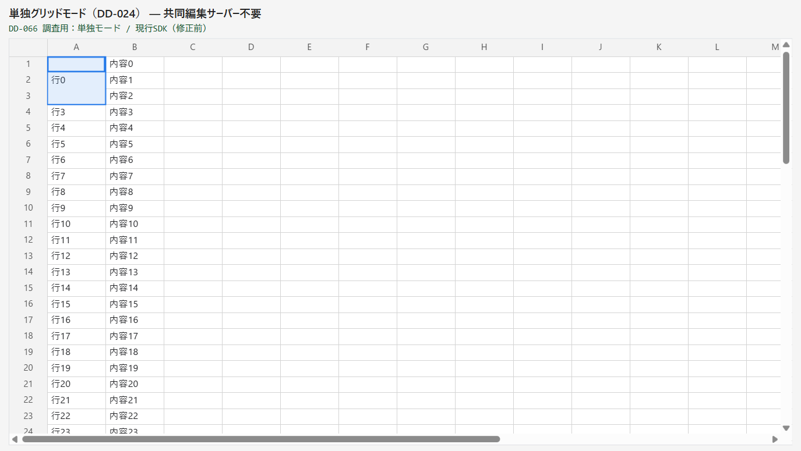
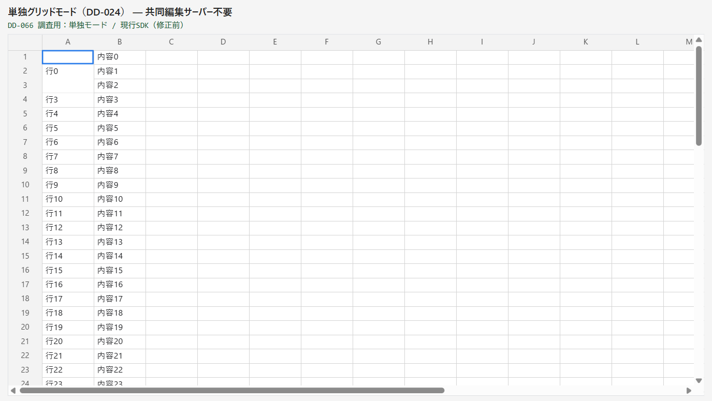
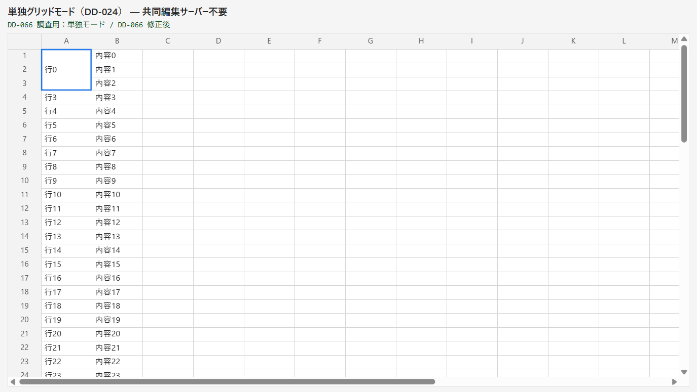
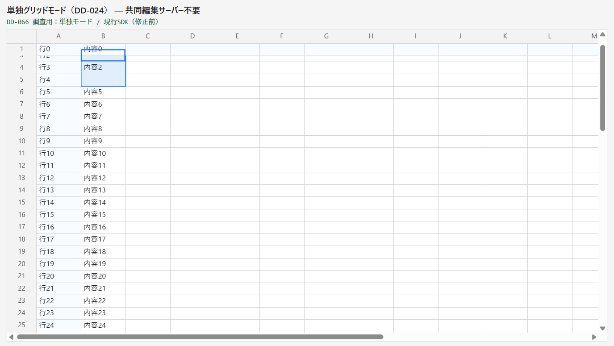
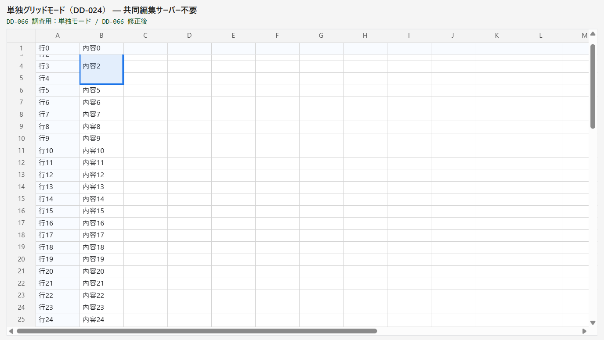
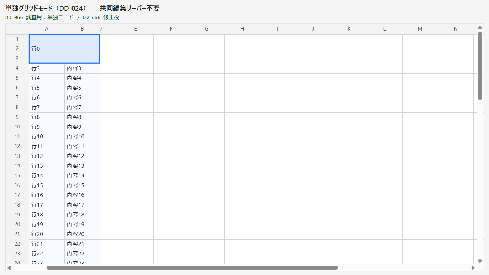

# DD-066 修正検証記録（2026-11-08）

## 対象

比較元は `7951231`（DD-065 完了後）。最終の配布対象は `76c4986`、`0.1.0-alpha.20`（10 package 同一版）、公開 API 版は `0.1.0-experimental` のまま。manifest は pack 後に追記する。

Navigation 中に結合の左上を示すときだけ、textarea の配置と可視判定に範囲全体の矩形を使う。実矩形をずらさず `clip-path:inset(...)` で所属 pane の内側だけに枠を表示する。通常の1セル・編集中・変換中は既存の計算を使い、clip を解除する。

## Before / After（同じ場面）

| 場面 | Before | After |
|---|---|---|
| 結合3行をクリック |  |  |
| 自動 focus なしの初期表示 |  |  |
| 結合の上端が固定行へ隠れる |  |  |
| 固定2列内の結合を横スクロール |  |  |

Playwright MCP・Chrome 156・DPR≈1.25・viewport1100×620 CSS px。初期表示・クリック・blur・通常セルの上端・結合の上端・左上セル不可視・固定列の横スクロールの7場面を同じ public mount の fixture で取り直した。修正前は `reproduction.json`、修正後は `after-reproduction.json`。公開 error イベントは全場面0件。

| 場面 | 修正前 | 修正後 |
|---|---|---|
| 3行×1列・mount/クリック/blur | textarea 80×22、結合80×66 | textarea 80×66。内側の1行ぶんの枠なし |
| 上端が固定行の下へ隠れる | y≈34.667・高さ22、clipなし | 同じy・高さ66、上約11.333pxをclip。pane上端46へはみ出さない |
| 左上1セルは不可視、結合の下部は可視 | `display:none` | y=18・高さ66・上28pxをclipして表示を維持 |
| 固定2列内の3行×2列・横スクロール120 | 80×22 | 160×66、x=52を維持 |
| 結合なしの1セル | 80×22、clipなし | 同じ矩形・clipなし |

## 回帰テスト

- 配置の純関数: `editor-placement.merged.test.ts` 8件（3行×2列・上下左右のclip・左上不可視・範囲全体不可視・固定行列の各pane・固定帯がviewportより大きい場合）
- 実物 E2E: `merged-editor-placement.spec.ts` 8件（初期focusなし・クリック・矢印で隣へ移動して合成日本語入力・上下左右のスクロールとfocus保持・固定列・結合解除・変換中の結合追加）
- 既存の配置17件・IME結線26件も期待値の変更なしで成功。既存の `computeEditorPlacement()` と wrap の高さ計算は変更していない
- `computeEditorPlacement()` を呼ぶ候補欄・日付も横展開で確認。結合では開かない既存の判定を保持し、新しい配置関数は editor の Navigation だけから呼ぶ

## 配布前の検証

| コマンド | 結果 |
|---|---|
| `npx vitest run packages/grid/src/editor-placement.merged.test.ts` | 8件成功 |
| `npx playwright test --config apps/playground/playwright.config.ts merged-editor-placement.spec.ts` | 8件成功 |
| `npm run typecheck` | 全 workspace 成功 |
| `npm run typecheck:consumer-strict` | 成功 |
| `npm run lint` | 成功。boundary 新規違反0、サイズ baseline は対象外のファイル3・関数1のまま |
| `npm test` | 162ファイル・1,681件成功（並行検証終了後の単独実行、26.56秒） |
| `npm run build` | 成功 |
| playground 全 E2E | 298件成功（5.6分）。共同編集・React・IME合成・wrap・候補欄・日付・性能を含む |
| showcase 全 E2E | 5件成功（14.9秒） |

最初の並行検証では、実 Git を使うガードのテストの beforeAll が10秒でタイムアウト（161ファイル成功・当該5件skip）。他の検証が終了した後、当該5件は単独で成功（4.62秒）。テストの内容や制限時間は変更せず、全 unit の単独実行も全1,681件成功。ログは `test-results/dd-evidence/DD-066/`。

上記の最終検証は76c4986に対応するソース・依存・lockfile・設定で実施した（Windows・Node.js 24.22.1・npm 11.19.1）。以後は実行コード・配布closureを変更せず、文書だけを整備。検証済みの同一対象への pack は `build-release.sh --skip-verify` を使い、manifest と内容の検査は別途行う。

`bash scripts/consumer-harness.sh` も成功。76c4986 の10 tarballを展開実体として独立installし、公開面だけで型検査した（source/test-support/内部import/ワークスペースリンクなし）。

## セルフレビュー・製品化6観点

- 公開面: Facade の入口、GridMountOptions/GridInstance/React props、IME状態機械とprotocolは変更なし。内部 editor の任意 getter と配置の純関数だけを追加
- 境界: `mount/editor-wiring.ts` が既存の結合 owner の getter を渡す。mount-controller.ts は605行のまま。共有 state の追加や循環 import は不要
- 再利用性: 案件固有の列名・行数は実装へ持たず、任意の結合範囲と可変行列サイズを共通の矩形計算で扱う
- 拡張性: 結合の描画・クリックと同じ直前の merge index を読む。固定境界をまたぐ指定は既存契約で拒否する
- DX: README・CHANGELOG・機能カタログ・DD-064の現在の契約へ反映。`autofocus=0` は playground の再現用 query だけで、SDK 公開オプションではない
- 互換性: 既存の通常セル・wrap・候補欄・日付は従来経路を保持。CSSOMのinset短縮による毎フレームの再代入は、要求したclip値をowner内で保持して防ぐ

Phase 0 の Codex high は指摘なし（`codex-review-result.md`）。実装はセルフレビューと回帰テストで確認し、実装後の別プロセスレビューは未実施。

## 配布物の検査

- `bash scripts/release/build-release.sh --skip-verify --out release/0.1.0-alpha.20`: 成功。10 tarball・141 files、test/spec・tsconfigなし、全entrypointあり
- `node scripts/release/verify-manifest.mjs release/0.1.0-alpha.20`: 成功。全tarballのSHA-256・版・サイズがmanifestと一致
- manifest: `gitCommit=76c498617426321d9ddf1b83b1c7c9aa4d734511`、`closureDirty=false`。`gitDirty=true` はDDの文書・画像だけ
- ZIP: `C:/repo/spreadjs/release/nanairo-sheet-0.1.0-alpha.20.zip`（451,001 bytes）。SHA-256: `07a5e4ca75bf84969618056d3a5df413e95c63c3a5d16b54cdd5cd0d154ed6a1`
- ZIPは12 entry（10 tarball・manifest・README）。全entryを読み出して元ファイルのSHA-256と照合し、内容が一致することを確認
- consumerへの引き渡し手順・残る画面確認は `handoff.md`。ZIPのREADMEも同じ内容

## 受け入れ基準

| AC | 結果 |
|---|---|
| 1 結合全体の枠 | E2E・After画像・80×66の矩形で確認 |
| 2 自動focusなしの初期表示 | E2E・After画像で確認 |
| 3 隣へ移動して入力 | E2Eで1セルの矩形へ復帰し、合成日本語入力の確定を確認 |
| 4 部分不可視・固定帯 | 縦横・左上不可視・固定列・focus保持のE2Eと画像で確認 |
| 5 通常セル・wrap・候補欄・日付 | 既存の期待値を変えず、全unit・E2Eが成功 |
| 6 consumer取り込み | 10 tarballとZIP・手順を準備。consumer側の画面確認へ移管し、下記の未保証境界に記録 |

## 既知の未保証境界

- 実 Microsoft IME の変換窓の位置は未確認。合成 composition の成功と区別する。Manual Gate はクローズをブロックしない
- consumer（hiroshima-keikaku）での取り込み・入力シートの画面確認（AC6）は consumer 側で実施する
